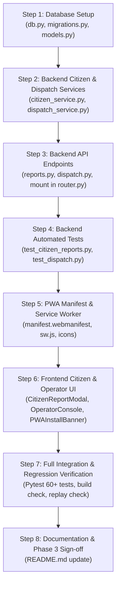

# FloodSense AI — Phase 3 Implementation Plan
## Citizen Intelligence and Response Coordination

**Document Version:** 1.0  
**Status:** Awaiting Review & Approval  
**Target Phase:** Phase 3 (Citizen Intelligence, Installable PWA, Crowdsourced Ground Truth & Municipal Dispatch Coordination)  
**Baseline Status:** Phase 1 (Data Grounding) & Phase 2 (Physical Risk Engine, Validation & Historical Replay) are **FROZEN** and **PROTECTED**.

---

## 1. Executive Summary & Protected Baseline

Phase 3 builds upon the deterministic physical modeling, historical incident ledger, and historical storm replay capabilities established in Phases 1 and 2. 

The objectives of Phase 3 are:
1. **Citizen Access & PWA Enablement**: Provide responsive citizen mobile/desktop access with an installable Progressive Web App (PWA) that caches app shell assets for complete local offline resilience.
2. **Crowdsourced Citizen Ground-Truth Intelligence**: Enable citizens to submit hyperlocal waterlogging observations as well as verified clear/dry observations (`control_clear`), solving the historical absence of negative control data.
3. **Bilingual Citizen Early-Warning Advisories**: Deliver clear, actionable travel and underpass avoidance advisories in both **English** and **Kannada (ಕನ್ನಡ)**.
4. **Municipal Emergency Response Coordination (BBMP / Police Console)**: Provide a municipal triage console for verifying citizen reports, dispatching trailer-mounted dewatering pumps, and issuing road barricade orders.
5. **Local-First Architecture**: Maintain 100% local-first deployment with SQLite on-disk persistence, local static file uploads, and offline queue synchronization.

### Strict Baseline Preservation Constraints:
- **Zero Regression on Phase 1 & Phase 2**: The 14 verified incidents in `data/raw/incidents.csv`, 3-year hourly reanalysis features in `data/processed/features.csv`, dataset checksums in `data/manifests/dataset_manifest.json`, and all 53 automated unit/integration tests must remain untouched and fully passing.
- **Physical Model & Risk Contracts**: Public API schemas (`SpotRisk`, `Spot`, `Rainfall`, `ReplayState`) and risk scoring thresholds ($\ge 0.35$ Amber, $\ge 0.65$ Red) must not be renamed or broken.
- **Replay Engine Isolation**: Historical storm replay sessions (`ev_20220905_deluge`, `ev_20230521_cloudburst`, `ev_20241021_cloudburst`) must remain isolated from retrospective outcomes.

---

## 2. Existing Architecture & Exact File Paths

### 2.1 Backend Architecture (`backend/`)
- **Application Entry Point**: [`backend/app/main.py`](file:///Users/atishpardeshi/Downloads/floodsense-ai/backend/app/main.py)
  - Configures FastAPI app, CORS middleware for `http://localhost:5173`, and mounts the root `api_router`.
- **API Routing**: [`backend/app/api/router.py`](file:///Users/atishpardeshi/Downloads/floodsense-ai/backend/app/api/router.py)
  - Prefixes routes with `/api`:
    - `/health`: [`endpoints/health.py`](file:///Users/atishpardeshi/Downloads/floodsense-ai/backend/app/api/endpoints/health.py)
    - `/spots`, `/risk`: [`endpoints/risk.py`](file:///Users/atishpardeshi/Downloads/floodsense-ai/backend/app/api/endpoints/risk.py)
    - `/replay/*`: [`endpoints/replay.py`](file:///Users/atishpardeshi/Downloads/floodsense-ai/backend/app/api/endpoints/replay.py)
    - `/weather/*`: [`endpoints/weather.py`](file:///Users/atishpardeshi/Downloads/floodsense-ai/backend/app/api/endpoints/weather.py)
    - `/agent/*`: [`endpoints/agent.py`](file:///Users/atishpardeshi/Downloads/floodsense-ai/backend/app/api/endpoints/agent.py)
- **Domain Services**:
  - Physical Risk Engine: [`backend/app/services/physical_risk.py`](file:///Users/atishpardeshi/Downloads/floodsense-ai/backend/app/services/physical_risk.py)
  - Terrain & DEM Service: [`backend/app/services/terrain_service.py`](file:///Users/atishpardeshi/Downloads/floodsense-ai/backend/app/services/terrain_service.py)
  - Risk Orchestration & ML Integration Layer: [`backend/app/services/risk_engine.py`](file:///Users/atishpardeshi/Downloads/floodsense-ai/backend/app/services/risk_engine.py)
  - Optional ML Risk Stub: [`backend/app/services/ml_risk_model.py`](file:///Users/atishpardeshi/Downloads/floodsense-ai/backend/app/services/ml_risk_model.py)
  - Historical Validation: [`backend/app/services/validation.py`](file:///Users/atishpardeshi/Downloads/floodsense-ai/backend/app/services/validation.py)
  - Live Weather Ingestion & Caching: [`backend/app/services/weather_service.py`](file:///Users/atishpardeshi/Downloads/floodsense-ai/backend/app/services/weather_service.py)
  - Early-Warning Advisory Orchestrator: [`backend/app/services/agent_service.py`](file:///Users/atishpardeshi/Downloads/floodsense-ai/backend/app/services/agent_service.py)
- **Demo & Simulation**:
  - Scenario Definitions: [`backend/app/demo/scenarios.py`](file:///Users/atishpardeshi/Downloads/floodsense-ai/backend/app/demo/scenarios.py)
  - Stateful Replay Engine: [`backend/app/demo/replay_engine.py`](file:///Users/atishpardeshi/Downloads/floodsense-ai/backend/app/demo/replay_engine.py)
  - Pilot Spot Fixtures: [`backend/app/demo/fixtures.py`](file:///Users/atishpardeshi/Downloads/floodsense-ai/backend/app/demo/fixtures.py)
- **Schemas & Constants**:
  - Core Schemas: [`backend/app/database/schemas.py`](file:///Users/atishpardeshi/Downloads/floodsense-ai/backend/app/database/schemas.py)
  - System Constants: [`backend/app/core/constants.py`](file:///Users/atishpardeshi/Downloads/floodsense-ai/backend/app/core/constants.py)
- **Data Engineering Scripts**:
  - Open-Meteo Ingestion & 3-State Labeling: [`backend/scripts/prepare_data.py`](file:///Users/atishpardeshi/Downloads/floodsense-ai/backend/scripts/prepare_data.py)
  - DEM Extraction: [`backend/scripts/download_dem.py`](file:///Users/atishpardeshi/Downloads/floodsense-ai/backend/scripts/download_dem.py)
  - OSM Overpass Downloader: [`backend/scripts/prepare_osm.py`](file:///Users/atishpardeshi/Downloads/floodsense-ai/backend/scripts/prepare_osm.py)
  - Validation Evaluator: [`backend/scripts/evaluate.py`](file:///Users/atishpardeshi/Downloads/floodsense-ai/backend/scripts/evaluate.py)

### 2.2 Frontend Architecture (`frontend/`)
- **HTML & Template**: [`frontend/index.html`](file:///Users/atishpardeshi/Downloads/floodsense-ai/frontend/index.html)
- **Application Root**: [`frontend/src/App.tsx`](file:///Users/atishpardeshi/Downloads/floodsense-ai/frontend/src/App.tsx)
- **Entry Point**: [`frontend/src/main.tsx`](file:///Users/atishpardeshi/Downloads/floodsense-ai/frontend/src/main.tsx)
- **Data Types**: [`frontend/src/types/index.ts`](file:///Users/atishpardeshi/Downloads/floodsense-ai/frontend/src/types/index.ts)
- **Global Styles**: [`frontend/src/styles.css`](file:///Users/atishpardeshi/Downloads/floodsense-ai/frontend/src/styles.css)
- **API Client**: [`frontend/src/services/api.ts`](file:///Users/atishpardeshi/Downloads/floodsense-ai/frontend/src/services/api.ts)
- **Components**:
  - Interactive Leaflet Map: [`frontend/src/components/map/FloodMap.tsx`](file:///Users/atishpardeshi/Downloads/floodsense-ai/frontend/src/components/map/FloodMap.tsx)
  - Dynamic Circle Markers & Popups: [`frontend/src/components/map/RiskMarker.tsx`](file:///Users/atishpardeshi/Downloads/floodsense-ai/frontend/src/components/map/RiskMarker.tsx)
  - Spot Risk List Overview: [`frontend/src/components/dashboard/RiskOverview.tsx`](file:///Users/atishpardeshi/Downloads/floodsense-ai/frontend/src/components/dashboard/RiskOverview.tsx)
  - Historical Storm Replay Dashboard: [`frontend/src/components/dashboard/Simulation.tsx`](file:///Users/atishpardeshi/Downloads/floodsense-ai/frontend/src/components/dashboard/Simulation.tsx)
  - AI Early-Warning Advisory View: [`frontend/src/components/dashboard/AgentAdvisoryView.tsx`](file:///Users/atishpardeshi/Downloads/floodsense-ai/frontend/src/components/dashboard/AgentAdvisoryView.tsx)

---

## 3. Database, Persistence & Migration Strategy

### 3.1 Current State
- The application currently relies on file-based CSV/JSON data and in-memory session objects (`ReplayManager`).
- No relational SQL database or migration framework (Alembic) exists in the repository.

### 3.2 Phase 3 Database Decision: SQLite (Local-First)
To honor the **strictly local-first deployment** requirement with zero cloud dependencies:
- **Database Engine**: SQLite via Python's built-in `sqlite3` module.
- **Database File Location**: `data/floodsense.db` (gitignored, initialized automatically on first run).
- **Rationale**:
  - Standard library inclusion: No external binary drivers, PostgreSQL services, or Docker daemons required.
  - ACID guarantees: Safe concurrent reads and transactional writes for crowd reports.
  - Portability: Single-file database can be backed up, inspected with GUI viewers, or bundled for demo packaging.

### 3.3 Relational Schema Design

```sql
-- 1. Citizen Flood & Control Reports
CREATE TABLE IF NOT EXISTS citizen_reports (
    report_id TEXT PRIMARY KEY,
    spot_id TEXT NOT NULL,
    report_type TEXT NOT NULL CHECK (report_type IN ('flood', 'control_clear')),
    water_depth_cm REAL,
    severity INTEGER CHECK (severity IN (1, 2, 3)),
    latitude REAL NOT NULL,
    longitude REAL NOT NULL,
    image_filename TEXT,
    reporter_alias TEXT DEFAULT 'Anonymous Citizen',
    verification_status TEXT NOT NULL DEFAULT 'pending' CHECK (verification_status IN ('pending', 'verified', 'rejected')),
    verified_at TEXT,
    verified_by TEXT,
    notes TEXT,
    created_at TEXT NOT NULL
);

-- Index for spatial & spot querying
CREATE INDEX IF NOT EXISTS idx_reports_spot ON citizen_reports(spot_id, created_at);
CREATE INDEX IF NOT EXISTS idx_reports_status ON citizen_reports(verification_status);

-- 2. Municipal Dewatering & Barricade Dispatch Directives
CREATE TABLE IF NOT EXISTS municipal_dispatches (
    dispatch_id TEXT PRIMARY KEY,
    spot_id TEXT NOT NULL,
    report_id TEXT,
    directive_type TEXT NOT NULL CHECK (directive_type IN ('pump_deployment', 'barricade_order', 'traffic_diversion')),
    priority TEXT NOT NULL CHECK (priority IN ('P1_CRITICAL', 'P2_ELEVATED', 'P3_ROUTINE')),
    status TEXT NOT NULL DEFAULT 'ordered' CHECK (status IN ('ordered', 'en_route', 'active', 'demobilized')),
    location_name TEXT NOT NULL,
    capacity_gpm TEXT,
    action_instructions TEXT NOT NULL,
    assigned_team TEXT,
    created_at TEXT NOT NULL,
    updated_at TEXT NOT NULL,
    FOREIGN KEY(report_id) REFERENCES citizen_reports(report_id)
);

CREATE INDEX IF NOT EXISTS idx_dispatch_status ON municipal_dispatches(status);

-- 3. Audit Log for Response Actions
CREATE TABLE IF NOT EXISTS response_audit_log (
    log_id INTEGER PRIMARY KEY AUTOINCREMENT,
    event_timestamp TEXT NOT NULL,
    action TEXT NOT NULL,
    actor_role TEXT NOT NULL CHECK (actor_role IN ('citizen', 'municipal_operator', 'system_agent')),
    details_json TEXT NOT NULL
);
```

### 3.4 Migration Strategy
Rather than introducing heavy external dependencies, Phase 3 will use a robust, lightweight schema initializer and version runner in [`backend/app/database/migrations.py`](file:///Users/atishpardeshi/Downloads/floodsense-ai/backend/app/database/migrations.py):
- Checks SQLite `PRAGMA user_version`.
- Applies incremental migration scripts transactionally.
- Automatically initializes `data/floodsense.db` upon server startup if absent.

---

## 4. Local Authentication & Role Separation

### 4.1 Current State
All endpoints are currently public and unauthenticated.

### 4.2 Phase 3 Local-First Role Architecture
To support both citizen self-service and municipal command without requiring external cloud OAuth providers (e.g. Auth0/Firebase):
- **Role Model**:
  - `Citizen`: Can query spot risks, view live advisories, and submit flood reports or clear-pass reports.
  - `Municipal Operator` (BBMP Disaster Management Cell / Bengaluru Traffic Police): Can view unverified reports, confirm/reject crowd claims, issue pump deployments, and update barricade states.
- **Authentication Mechanism**:
  - HTTP Header / Session Token: `X-FloodSense-Role: operator` or `X-FloodSense-Role: citizen`.
  - Operator Passcode: In production/evaluation mode, requests claiming `operator` role provide an `X-Operator-Key` header validated against an optional environment variable `OPERATOR_PASSCODE` (defaulting to a permissive local development key `bbmp-control-2026`).
  - Frontend Role Switcher: The UI header will include a role toggle pill (`👤 Citizen Mode` vs `🚜 BBMP Operator Console`) allowing seamless demonstration during evaluations.

---

## 5. Static Files, Evidence Uploads & Local Caching

### 5.1 Evidence Image Storage
- **Directory**: `data/uploads/reports/` (created automatically and gitignored).
- **Validation Rules**:
  - Allowed MIME types: `image/jpeg`, `image/png`, `image/webp`.
  - Maximum upload size: 5.0 MB.
  - File naming: Sanitized UUID `rep_<uuid>.jpg` to prevent directory traversal attacks.
- **FastAPI Static Mount**:
  - Mount `StaticFiles(directory="data/uploads")` at `/static/uploads` to safely render photos in popups and the municipal triage dashboard.
  - Required dependency: Add `python-multipart` to `backend/requirements.txt` for standard FastAPI form-data upload handling.

### 5.2 PWA & Offline Strategy
- **Web App Manifest**: `frontend/public/manifest.webmanifest` defining:
  - `name`: "FloodSense AI — Bengaluru Flood Early Warning"
  - `short_name`: "FloodSense"
  - `display`: "standalone"
  - `theme_color`: "#1f6f8b"
  - `background_color`: "#f6f8f9"
  - App icons in `frontend/public/icons/` (192x192 and 512x512).
- **Service Worker**: `frontend/public/sw.js`:
  - **Cache-First Strategy for App Shell**: HTML, CSS, JavaScript bundles, Leaflet marker graphics, and OpenStreetMap cached tile fallback.
  - **Network-First with Offline Queue for API**:
    - Queries for live risk return cached states if offline.
    - Citizen reports submitted offline are queued in browser `localStorage` or `IndexedDB` and automatically dispatched to `POST /api/reports` when `navigator.onLine` fires.
  - **PWA Status Banner**: UI indicates when the user is operating in offline mode with cached predictions.

---

## 6. Files That Must NOT Be Modified (Protected Baselines)

The following files represent the verified scientific grounding, physical mechanics, and validation foundations of Phases 1 and 2. They are strictly protected:

1. `data/raw/spots.csv`: Authoritative coordinates and IDs of the 8 pilot spots.
2. `data/raw/incidents.csv`: 14 verified historical Bengaluru flood incidents with news citations.
3. `data/processed/features.csv`: Processed 210,432-row hourly rainfall feature ledger.
4. `data/processed/labels.csv`: Three-state ground-truth labels (42 positive, 0 negative, 3,256 unknown).
5. `data/manifests/dataset_manifest.json`: Cryptographic SHA-256 provenance manifest.
6. `backend/app/services/physical_risk.py`: Deterministic physical risk engine.
7. `backend/app/services/terrain_service.py`: Spatial DEM elevation and central-difference slope calculation.
8. `backend/app/demo/scenarios.py`: Documented historical storm definitions.
9. `backend/app/demo/replay_engine.py`: Chronological replay engine with strict retrospective outcome isolation.
10. `backend/app/services/validation.py`: Event-based historical validation logic.

---

## 7. Existing Components to Reuse in Phase 3

| Component | File Path | Reuse Purpose in Phase 3 |
|---|---|---|
| `EarlyWarningAgent` | `backend/app/services/agent_service.py` | Supplies automated bilingual (English/Kannada) advisory text, underpass avoidance lists, and default pump mobilization schedules. |
| `WeatherService` | `backend/app/services/weather_service.py` | Supplies 15-minute live Open-Meteo precipitation nowcasts to contextualize citizen flood reports. |
| `SPOTS` & `Spot` schema | `backend/app/demo/fixtures.py`, `schemas.py` | Provides spot dropdowns and spatial coordinate anchors for report submission. |
| `FloodMap` & `RiskMarker` | `frontend/src/components/map/` | Reused to render citizen report pins (with distinct water droplet / checkmark icons) overlaid on physical risk circles. |
| `Simulation` | `frontend/src/components/dashboard/Simulation.tsx` | Continues to serve historical replay demonstrations without modification. |

---

## 8. New Files Proposed for Phase 3

### 8.1 Backend Additions
1. `backend/app/database/db.py`: SQLite connection pool, thread-safe connection context manager, and row helper.
2. `backend/app/database/migrations.py`: Schema migration runner executing DDL for reports, dispatches, and audit tables.
3. `backend/app/database/models.py`: Pydantic request/response models for citizen reports, verification actions, and municipal dispatches.
4. `backend/app/services/citizen_service.py`: Business logic for report submission, flood depth categorization, anti-spam rate limiting, and spatial spot mapping.
5. `backend/app/services/dispatch_service.py`: Business logic for municipal dewatering pump mobilization, barricade logging, and traffic diversion tracking.
6. `backend/app/api/endpoints/reports.py`: FastAPI endpoints for citizen report submission (`POST /api/reports`), report feeds (`GET /api/reports`), and report image viewing.
7. `backend/app/api/endpoints/dispatch.py`: FastAPI endpoints for operator report triage (`POST /api/reports/{id}/verify`) and pump dispatch management (`GET/POST /api/dispatch/*`).
8. `backend/tests/test_citizen_reports.py`: Automated pytest suite testing report submission, validation, control clear reporting, and error states.
9. `backend/tests/test_dispatch.py`: Automated pytest suite testing operator verification, pump dispatch creation, and status transitions.

### 8.2 Frontend Additions
1. `frontend/public/manifest.webmanifest`: Official PWA web manifest.
2. `frontend/public/sw.js`: Service worker handling offline caching and background synchronization.
3. `frontend/src/components/citizen/CitizenReportModal.tsx`: Accessible dialog for submitting waterlogging reports or clear-pass confirmations with photo upload.
4. `frontend/src/components/operator/OperatorConsole.tsx`: Municipal triage board for reviewing citizen reports, viewing photo evidence, and issuing pump deployments.
5. `frontend/src/components/common/PWAInstallBanner.tsx`: Non-intrusive installation prompt and offline indicator.
6. `frontend/src/services/reportsApi.ts`: Frontend API client functions for reports and dispatch endpoints.

---

## 9. API Contract Proposal for Phase 3

### 9.1 Citizen Report Submission
- **`POST /api/reports`**
  - **Description**: Submits a crowd-sourced waterlogging or clear-corridor report.
  - **Content-Type**: `multipart/form-data` (or JSON if photo omitted).
  - **Form Fields**:
    - `spot_id`: string (e.g. `kr_circle`)
    - `report_type`: `"flood"` | `"control_clear"`
    - `water_depth_cm`: float (optional, estimated water depth in cm)
    - `severity`: integer (1 = surface runoff, 2 = traffic halted, 3 = vehicle submerged)
    - `latitude`: float (optional user GPS; defaults to spot coordinates)
    - `longitude`: float
    - `image`: binary file (optional JPEG/PNG photo)
    - `reporter_alias`: string (optional, defaults to "Anonymous")
    - `notes`: string (optional descriptive observations)
  - **Response (201 Created)**:
    ```json
    {
      "report_id": "rep_9f8a3c21",
      "spot_id": "kr_circle",
      "report_type": "flood",
      "water_depth_cm": 45.0,
      "severity": 2,
      "verification_status": "pending",
      "created_at": "2026-11-10T14:30:00+05:30",
      "message": "Report submitted successfully. Transmitted to BBMP Disaster Monitoring Cell."
    }
    ```

### 9.2 Citizen Report Feed
- **`GET /api/reports`**
  - **Query Parameters**:
    - `spot_id`: string (optional filter)
    - `status`: `"pending"` | `"verified"` | `"all"` (default: `"all"`)
    - `limit`: integer (default: 50)
  - **Response (200 OK)**:
    ```json
    [
      {
        "report_id": "rep_9f8a3c21",
        "spot_id": "kr_circle",
        "spot_name": "KR Circle Underpass",
        "report_type": "flood",
        "water_depth_cm": 45.0,
        "severity": 2,
        "image_url": "/static/uploads/rep_9f8a3c21.jpg",
        "verification_status": "verified",
        "verified_at": "2026-11-10T14:35:10+05:30",
        "created_at": "2026-11-10T14:30:00+05:30",
        "notes": "Water up to car bumper; traffic diverting"
      }
    ]
    ```

### 9.3 Municipal Operator Triage
- **`POST /api/reports/{report_id}/verify`**
  - **Headers**: `X-FloodSense-Role: operator`
  - **Body**:
    ```json
    {
      "action": "verify",
      "operator_id": "bbmp_officer_4",
      "notes": "Confirmed by BTP traffic camera feeds."
    }
    ```
  - **Response (200 OK)**:
    ```json
    {
      "report_id": "rep_9f8a3c21",
      "verification_status": "verified",
      "verified_at": "2026-11-10T14:35:10+05:30",
      "verified_by": "bbmp_officer_4"
    }
    ```

### 9.4 Municipal Pump & Barricade Dispatch Management
- **`GET /api/dispatch/plan`**
  - **Response (200 OK)**: Returns active pump deployments, barricades, and diversions.
- **`POST /api/dispatch/orders`**
  - **Headers**: `X-FloodSense-Role: operator`
  - **Body**:
    ```json
    {
      "spot_id": "kr_circle",
      "directive_type": "pump_deployment",
      "priority": "P1_CRITICAL",
      "capacity_gpm": "500 GPM",
      "assigned_team": "BBMP East Stormwater Rapid Unit 2",
      "action_instructions": "Deploy diesel suction unit to north approach sump."
    }
    ```
  - **Response (201 Created)**:
    ```json
    {
      "dispatch_id": "disp_448a12",
      "status": "ordered",
      "created_at": "2026-11-10T14:36:00+05:30"
    }
    ```

---

## 10. Security, Privacy & Local Offline Strategy

### 10.1 Privacy Protections
- **No Mandatory Personally Identifiable Information (PII)**: Citizens are never forced to provide phone numbers, real names, or national IDs. The reporter alias defaults to "Anonymous Citizen".
- **Coordinate Fuzzing Option**: If a user shares precise device GPS rather than clicking a pre-configured spot anchor, coordinates are snapped to within 100 meters of the nearest roadway corridor to prevent revealing exact residential premises.
- **EXIF Metadata Stripping**: Uploaded photos have raw GPS and device serial metadata stripped before saving to disk.

### 10.2 Upload Security Controls
- **Content Validation**: Binary file headers (magic bytes) are checked to verify genuine JPEG/PNG/WebP format, preventing arbitrary executable uploads.
- **File System Boundary**: Files are written exclusively to `data/uploads/` using server-generated UUID names, neutralizing path traversal attacks (`../../etc/passwd`).
- **Quota & Size Limits**: Strict 5MB per image limit enforced before memory buffering.

### 10.3 Offline Fault Tolerance
- **PWA Service Worker**: Pre-caches static assets so the app opens reliably even if local internet or cell service drops during heavy downpours.
- **Client-Side Queueing**: When `POST /api/reports` fails due to lack of network, the report is saved in browser `localStorage`. A synchronization manager listens for the `online` event and flushes pending reports.
- **Zero Cloud API Hard Dependencies**: The entire backend operates locally with SQLite and local file caches without requiring internet access once the server is started.

---

## 11. Implementation Order

Phase 3 execution will follow this disciplined, step-by-step order:



1. **Step 1: Database Foundations**:
   - Create SQLite connection manager in `backend/app/database/db.py`.
   - Implement versioned migrations in `backend/app/database/migrations.py`.
   - Define Pydantic request/response schemas in `backend/app/database/models.py`.
2. **Step 2: Core Services**:
   - Implement `CitizenService` in `backend/app/services/citizen_service.py` (validation, persistence, spatial spot snapping).
   - Implement `DispatchService` in `backend/app/services/dispatch_service.py` (triage workflow, resource assignment).
3. **Step 3: API Endpoints**:
   - Create `backend/app/api/endpoints/reports.py` and `backend/app/api/endpoints/dispatch.py`.
   - Mount endpoints in `backend/app/api/router.py`.
   - Mount `StaticFiles` in `backend/app/main.py`.
4. **Step 4: Backend Testing**:
   - Write `backend/tests/test_citizen_reports.py` and `backend/tests/test_dispatch.py`.
   - Verify all existing 53 tests + new tests pass.
5. **Step 5: PWA Infrastructure**:
   - Create `frontend/public/manifest.webmanifest` and `frontend/public/sw.js`.
   - Update `frontend/index.html` with manifest link and service worker registration.
6. **Step 6: Frontend Components**:
   - Implement `CitizenReportModal.tsx` for submitting waterlogging/clear reports.
   - Implement `OperatorConsole.tsx` for BBMP triage and pump assignment.
   - Implement `PWAInstallBanner.tsx` for installable mobile experience.
   - Integrate modal triggers and operator toggle into `frontend/src/App.tsx`.
7. **Step 7: Verification**:
   - Run `PYTHONPATH=backend pytest backend/tests -v`.
   - Run `npm run build` in `frontend/`.
   - Smoke test live simulation, historical storm replay, crowd reporting, and operator dispatch.
8. **Step 8: Documentation**:
   - Update `README.md` with Phase 3 operational workflows.

---

## 12. Regression Test Plan

To ensure Phase 3 introduces zero regressions to Phases 1 and 2:

| Test Suite | Purpose | Target Criteria |
|---|---|---|
| `test_physical_risk.py` | Physical baseline scoring | Deterministic, bounded $[0.0, 1.0]$, weights normalize correctly. |
| `test_risk.py` | API risk response contracts | Thresholds unchanged, sorting preserved, lead times accurate. |
| `test_replay.py` | Historical storm replay | Replay sessions advance chronologically; predictions isolated from retrospective outcomes. |
| `test_validation.py` | Retrospective evaluation | Honest reporting of precision as unavailable; zero negative control handling intact. |
| `test_manifest.py` | Data provenance | Cryptographic SHA-256 hashes of all 46 raw/processed files match exactly. |
| `test_weather.py` | Live weather caching | 15-minute disk cache and offline fallback work without external network. |
| `test_agent.py` | AI Advisory synthesis | English and Kannada advisories synthesize properly with rule-based fallback. |
| `test_citizen_reports.py` *(New)* | Crowd reporting | Validates depth inputs, handles photo uploads, supports `control_clear` reports. |
| `test_dispatch.py` *(New)* | Municipal triage | Confirms operator verification, pump deployment directives, and role checks. |
| **Frontend Production Build** | Vite & TypeScript | `tsc && vite build` completes in $<1\text{s}$ with zero type errors. |

---

## 13. Stated Assumptions

1. **Storage Access**: The local environment allows writing to `data/floodsense.db` and creating subdirectories under `data/uploads/`.
2. **Network Independence**: The system is designed to demonstrate complete functionality offline using cached weather and deterministic rule synthesizers if internet access is interrupted.
3. **PWA Scope**: Service worker offline caching applies to the app shell and recent API queries; live external map tile caching is best-effort based on browser storage limits.
4. **Role Model Simplicity**: For hackathon evaluation and local pairing, role switching between Citizen and Operator is demonstrated via an accessible UI switcher backed by standard HTTP headers, without imposing complex external OAuth sign-in gates.

---
*Ready for user review and approval prior to implementation.*

